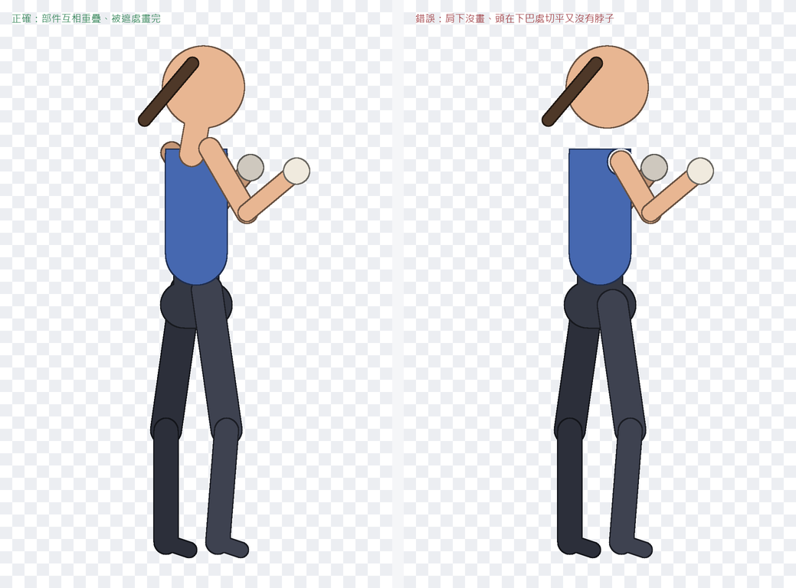
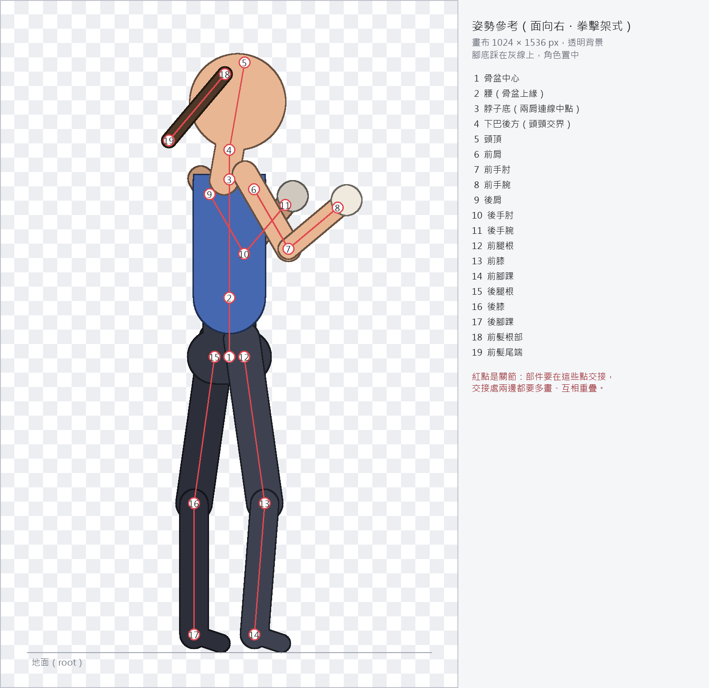
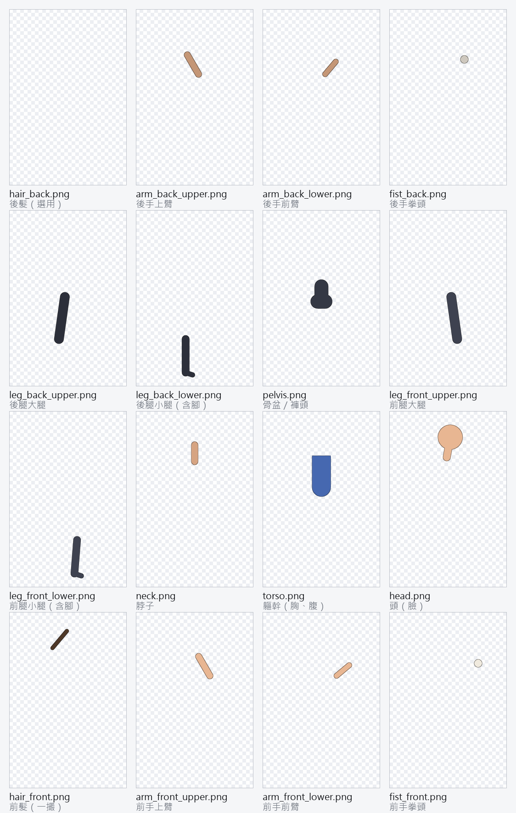

# 生圖交付規格：讓 AI 生的角色直接套上動作

動作是算在骨架上的。要讓 GPT、Gemini 或 MJ 生的角色「一套就動、動了不破」，圖必須做到三件事：

1. **姿勢對**：角色擺成模板的姿勢（面向右的拳擊架式）。姿勢差一點沒關係，工作室可以拖關節對齊。
2. **拆得對**：在關節處拆成固定檔名的圖層，每張都是整張畫布大小、留在原位。
3. **藏得住**：被別的部件擋住的地方也要畫完，關節兩邊互相重疊。這是最常破圖的原因。

第 2、3 點工作室會自動檢查：缺哪個圖層、哪個關節在第幾幀露出背景，都會直接告訴你。



---

## 流程

| 步驟 | 做什麼 | 用什麼 |
|---|---|---|
| 1 | 生出整身角色（一張圖），姿勢照參考圖 | GPT / Gemini / MJ + [姿勢參考圖](pose-reference.png) + 下面的提示詞 A |
| 2 | 拆成圖層，補畫被遮住的部分 | GPT / Gemini 分層輸出（提示詞 B），或在 Photoshop / Krita 手動拆 |
| 3 | 開工作室 →「從圖層建立角色」，一次選全部 PNG | `studio/spine-motion-studio.html` |
| 4 | 看圖層檢查清單；把 19 個紅點拖到真正的關節上；按「建立骨架」 | 工作室 |
| 5 | 挑動作、看流暢度分數和**接縫檢查**；有紅圈就回步驟 2 修那個關節的圖層 | 工作室 |
| 6 | 加入匯出清單 → 下載動畫 JSON；PNG 放進 JSON 旁的 `images/` 資料夾 → Spine 4.3 Import Data | Spine 4.3 |

同一個姿勢的第二個角色：在步驟 4 按「下載關節位置」存起來，下個角色「載入關節位置」再微調就好。

---

## 畫布與姿勢

- **畫布 1024 × 1536 px，PNG，透明背景。** 其他尺寸也可以，但所有圖層必須同尺寸；建議維持 2:3。
- **每個圖層都是整張畫布大小**，部件留在它在整身圖裡的位置。不要裁切、不要移動、不要縮放。
- **面向右**，拳擊架式：前手（靠近觀眾那隻）在前、拳頭約在下巴高度；後手護在臉頰旁；兩肘彎約 90°。
- **腳底踩在 y = 1456 的地面線**，兩腳中點約在 x = 512。
- 腿照參考圖即可。膝蓋再彎一點（5–15°）更好，彈跳會更有彈性；打直的腿也能用（腿部 IK 有柔化，不會「啪」一下打直）。
- 前髮一撮（`hair_front`）是選用的，有的話會跟著頭甩動。



### 關節位置（模板預設，畫布 px，y 向下）

工作室會自動從圖層猜關節，猜不準再用滑鼠拖。給能吃座標的 agent 時，也可以直接把這張表貼過去。

| # | 關節 | id | x, y |
|---|---|---|---|
| 1 | 骨盆中心 | `hip` | 512, 796 |
| 2 | 腰（骨盆上緣） | `waist` | 512, 664 |
| 3 | 脖子底（兩肩連線中點） | `neckBase` | 512, 400 |
| 4 | 下巴後方（頭頸交界） | `headBase` | 512, 334 |
| 5 | 頭頂 | `headTop` | 546, 139 |
| 6 | 前肩 | `shoulderF` | 567, 422 |
| 7 | 前手肘 | `elbowF` | 644, 555 |
| 8 | 前手腕 | `wristF` | 754, 463 |
| 9 | 後肩 | `shoulderB` | 468, 433 |
| 10 | 後手肘 | `elbowB` | 545, 566 |
| 11 | 後手腕 | `wristB` | 637, 457 |
| 12 | 前腿根 | `hipF` | 545, 796 |
| 13 | 前膝 | `kneeF` | 591, 1123 |
| 14 | 前腳踝 | `ankleF` | 568, 1416 |
| 15 | 後腿根 | `hipB` | 479, 796 |
| 16 | 後膝 | `kneeB` | 433, 1123 |
| 17 | 後腳踝 | `ankleB` | 433, 1416 |
| 18 | 前髮根部 | `hairRoot` | 502, 165 |
| 19 | 前髮尾端 | `hairTip` | 377, 313 |

---

## 圖層清單

檔名一定要照這張表（小寫、底線；`Arm-Front-Upper.PNG` 這種工作室會自動轉成 `arm_front_upper`）。順序就是疊圖順序，1 在最後面。

| # | 檔名 | 部位 | | 跟著哪根骨 | 被遮住、要多畫的地方 |
|---|---|---|---|---|---|
| 1 | `hair_back.png` | 後髮 | 選用 | head | 被頭擋住的部分整片畫完 |
| 2 | `arm_back_upper.png` | 後手上臂 | 必要 | upperArmB | 肩膀端多畫進軀幹裡、手肘端畫成圓頭 |
| 3 | `arm_back_lower.png` | 後手前臂 | 必要 | foreArmB | 手肘端畫成圓頭，與上臂重疊 |
| 4 | `fist_back.png` | 後手拳頭 | 必要 | handB | 手腕端多畫一段，與前臂重疊 |
| 5 | `leg_back_upper.png` | 後腿大腿 | 必要 | thighB | 腿根多畫進骨盆裡、膝蓋畫成圓頭 |
| 6 | `leg_back_lower.png` | 後腿小腿（含腳） | 必要 | shinB | 膝蓋端畫成圓頭，與大腿重疊 |
| 7 | `pelvis.png` | 骨盆／褲頭 | 必要 | hip | 上緣多畫進軀幹裡，兩側腿根處畫滿 |
| 8 | `leg_front_upper.png` | 前腿大腿 | 必要 | thighF | 腿根多畫進骨盆裡、膝蓋畫成圓頭 |
| 9 | `leg_front_lower.png` | 前腿小腿（含腳） | 必要 | shinF | 膝蓋端畫成圓頭，與大腿重疊 |
| 10 | `neck.png` | 脖子 | 選用 | neck | 上端多畫伸進頭裡，下端多畫藏到軀幹（衣領）後面 |
| 11 | `torso.png` | 軀幹（胸、腹） | 必要 | chest | 兩肩下方、被手臂擋住的胸口與腋下都要畫完 |
| 12 | `head.png` | 頭（臉） | 必要 | head | 有脖子圖層：下巴下方多畫一點；沒有脖子圖層：多畫一段脖子伸進軀幹 |
| 13 | `hair_front.png` | 前髮（一撮） | 選用 | hairF | 髮根多畫進頭裡 |
| 14 | `arm_front_upper.png` | 前手上臂 | 必要 | upperArmF | 肩膀端多畫進軀幹裡、手肘端畫成圓頭 |
| 15 | `arm_front_lower.png` | 前手前臂 | 必要 | foreArmF | 手肘端畫成圓頭，與上臂重疊 |
| 16 | `fist_front.png` | 前手拳頭 | 必要 | handF | 手腕端多畫一段，與前臂重疊 |

- 前髮可以有好幾撮：`hair_front.png`、`hair_front_2.png`… 都會跟著同一根前髮骨。
- 脖子疊在軀幹**後面**，所以脖子下端可以放心多畫，會藏在衣領後。沒有脖子圖層也行，但頭就必須自己多畫一段脖子（第 12 列），那一段會疊在軀幹上面。
- 不在表上的檔名不會被使用，工作室會列出來提醒你。



---

## 三條鐵律（破圖幾乎都是違反這三條）

1. **被擋住的地方要畫完。** 手臂擋住的胸口、腋下，頭擋住的後髮，都要畫。動作一揮手，被擋的地方就露出來。
2. **關節兩邊要重疊，重疊處不要描邊。** 上臂的肩膀端伸進軀幹裡至少 40 px；肘、膝畫成圓頭，讓前臂、小腿轉動時永遠蓋得住。圓頭疊在別的部件上面的那一段不要畫黑色描邊，顏色和陰影跟下面接順；描邊只留在外側輪廓。不然每個關節都會多出一圈圓線，看起來像人偶。
3. **不要在關節處切平。** 最常見的是頭在下巴切平、又沒有脖子圖層：頭一轉就看到一條縫。

生圖 agent 最容易出錯的就是第 1、2 條：它會把「看得見的部分」剪下來交給你。所以拆圖的提示詞要特別強調「補畫被遮住的部分」。

---

## 提示詞

把[姿勢參考圖](pose-reference.png)和整身角色圖一起附上效果最好。方括號裡換成你的角色。

### A. 生整身角色

**GPT / Gemini（中文）**

```
請畫一個 [角色描述：例如 穿紅色拳擊短褲的光頭拳擊手，2D 卡通風格，粗黑描邊、平塗上色]。
要求：
- 全身、正側面偏 3/4，面向畫面右方，拳擊架式：前手拳頭在下巴高度往前伸，後手護在臉頰旁，兩肘彎約 90 度。
- 兩腳站穩，膝蓋微彎，腳底在畫面下緣上方約 5% 的位置，角色水平置中。
- 畫布 1024×1536（直式 2:3），純透明背景，沒有地面陰影、沒有特效、沒有文字。
- 四肢之間要分得開：手臂不要整隻貼在身體上，兩腿之間留空隙，方便之後拆成部件。
- 姿勢與比例照附上的參考圖。
```

**GPT / Gemini（English）**

```
Draw [character: e.g. a bald boxer in red trunks, 2D cartoon style, thick black outlines, flat colors].
Requirements:
- Full body, side view turned slightly toward the viewer (3/4), facing RIGHT, boxing guard: lead fist forward at chin height, rear fist guarding the cheek, both elbows bent about 90 degrees.
- Feet planted, knees slightly bent, soles about 5% above the bottom edge, character centered horizontally.
- Canvas 1024x1536 (portrait 2:3), fully transparent background, no ground shadow, no effects, no text.
- Keep limbs separated: arms not pressed flat against the body, a gap between the legs, so the figure can be cut into parts.
- Match the pose and proportions of the attached reference image.
```

**Midjourney**：MJ 適合做角色設計，但不能指定透明背景、也無法分層，姿勢也比較難精準。建議用 MJ 定出角色外觀，再把那張圖交給 GPT / Gemini 照參考圖重擺姿勢（上面的提示詞 A），然後做 B。MJ 端可用 `--ar 2:3`，並在描述裡寫 `full body, side view facing right, boxing stance, plain white background, flat 2D, thick outlines`；同一角色多張時用 MJ 的角色參考功能保持一致。

### B. 拆成圖層

一次拆一個部件最穩。對每個檔名重複這段，把 `[檔名]`、`[部位]`、`[要多畫的地方]` 換成上面圖層表那一列。

**中文**

```
這是同一個角色的整身圖。請只輸出它的「[部位]」，存成 [檔名]：
- 畫布與原圖完全相同（1024×1536），部件留在原本的位置與大小，不要裁切、不要移動、不要縮放。
- 透明背景，其他部位全部去掉。
- 被其他部位擋住的部分要補畫完整：[要多畫的地方]。補畫的部分要和看得見的部分畫風、顏色、描邊一致。
- 關節那一端畫成圓頭，比原本的交界線多延伸約 40 像素，讓它可以和相鄰部件重疊。
- 圓頭疊在相鄰部件上的那一段不要畫描邊，只保留外側輪廓的描邊。
```

**English**

```
This is a full-body image of one character. Output ONLY its [part] as [file name]:
- Same canvas as the original (1024x1536). Keep the part exactly where it is, same size. Do not crop, move or scale it.
- Transparent background; remove every other body part.
- Paint in everything that is hidden behind other parts: [what to extend]. Match the style, colors and outlines of the visible part.
- Make the joint end a rounded cap that extends about 40 px past the original seam, so it overlaps the neighbouring part.
- No outline on the part of that cap that lies over the neighbouring part; keep the outline only on the outer silhouette.
```

`[要多畫的地方]` 的英文對照：

| 檔名 | what to extend |
|---|---|
| `torso` | the chest and armpits under both shoulders, everything the arms cover |
| `head` | with a neck layer: a little below the chin; without one: a short neck reaching down into the torso |
| `neck` | the top reaching up into the head; the bottom continuing down behind the collar |
| `pelvis` | the top edge reaching up into the torso; fill both hip sockets |
| `*_upper`（手臂） | the shoulder end reaching into the torso; a rounded elbow |
| `*_lower`（手臂） | a rounded elbow end overlapping the upper arm |
| `fist_*` | a short piece of wrist overlapping the forearm |
| `leg_*_upper` | the hip end reaching into the pelvis; a rounded knee |
| `leg_*_lower` | a rounded knee end overlapping the thigh |
| `hair_back` | the whole back of the hair, including what the head covers |
| `hair_front` | the root of the strand, reaching into the head |

**一次分層輸出**：有些工具可以直接輸出分層 PSD 或一組 PNG。照樣把圖層表和三條鐵律貼給它，拿回來後用工作室檢查；檔名不對就改檔名。

---

## 交件檢查清單

- [ ] 檔名照圖層表，必要的 13 個都有
- [ ] 所有 PNG 同尺寸、透明背景、沒有裁切
- [ ] 在工作室的「關節對齊」畫面，疊起來是完整的角色、沒有錯位
- [ ] 19 個紅點都在真正的關節上（肩、肘、腕、腿根、膝、踝、脖子、下巴後方、頭頂、髮根、髮尾）
- [ ] 建立骨架後沒有「IK 解出的位置和畫的關節差 … px」的警告
- [ ] 要用的每個動作：接縫檢查顯示「✓ 每一幀的關節都沒有露底」

## 工作室的訊息怎麼看

| 訊息 | 原因 | 怎麼修 |
|---|---|---|
| 缺少必要圖層 | 檔名不對或沒交 | 改檔名或補圖層；缺的部位不會顯示 |
| 尺寸 … 和其他圖層不同 | 有一張被裁切或縮放 | 放回原畫布大小、原位置 |
| 檔名不在模板裡 | 例如 `arm.png` | 改成圖層表的檔名 |
| 整張是透明的／沒有透明背景 | 匯出設定錯 | 重新匯出 PNG（含 alpha） |
| 某關節：靜止時就有缺口 | 被擋處沒畫，或在關節切平 | 補畫那個關節兩側的圖層（鐵律 1、3） |
| 某關節：第 x s 露底 | 動到那一幀時重疊不夠 | 把關節端畫成圓頭、多延伸（鐵律 2）；按「看這一幀」看紅圈位置 |
| IK 解出的位置和畫的關節差 … px | 關節點沒對準 | 回關節對齊，拖準肘、膝 |
| 骨骼 … 的兩個關節幾乎重疊 | 兩個紅點疊在一起 | 把它們分開拖到正確位置 |

## 匯出到 Spine 4.3

1. 工作室「下載動畫 JSON」→ 得到 `角色名.motion.json`（骨架、圖層、動畫都在裡面）。
2. 在 JSON 旁邊建 `images/` 資料夾，放入你的圖層 PNG（檔名不變）。
3. Spine 4.3：Import Data → 選 JSON。打包 atlas 時開啟 Strip whitespace，透明邊會被裁掉，不浪費空間。
4. 腿部 IK 已設好柔化（softness），彈跳時膝蓋不會突然打直；手臂 IK 由動作本身控制伸展距離。

## 限制

- 一套模板 = 一種姿勢（面向右的拳擊架式、側面）。正面角色、四足動物、長裙、披風等需要別的模板。
- 角色面向左：最簡單是把整套圖層水平翻轉、當成面向右的角色做；工作室的「面向左」只改動作方向，不會翻圖。
- 生圖工具每次姿勢都會略有不同，所以才需要拖關節。比例差太多（例如手臂畫成打直），動作會變得奇怪，建議重生。
- 符號類（SYMBOL、標題字）不用這套模板：直接在 Spine 做一根骨的骨架，用「開啟骨架 JSON」套符號動作。
