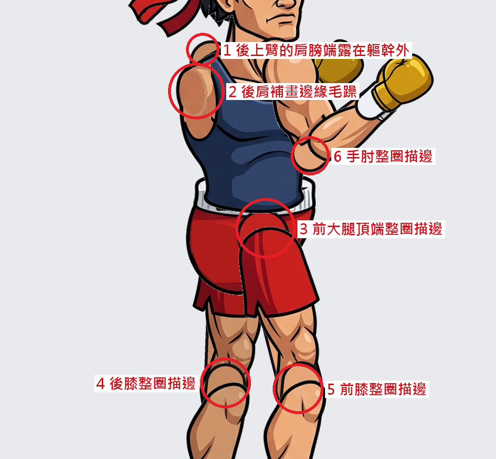

# 驗收回饋：AI生圖交付_v1

動畫可以用：16 張圖層齊全、尺寸正確，6 個動作都能正常播放，每一幀都沒有露出背景。下面 6 處是外觀問題，修好之後會更自然。

| # | 圖層檔 | 問題 | 怎麼改 |
|---|---|---|---|
| 1 | `arm_back_upper.png` | 肩膀端畫到軀幹輪廓外面，脖子後方一直多一塊膚色凸起，每一幀都看得到 | 肩膀端多畫的部分要收在 `torso` 的輪廓裡面，超出背心外緣的那一截擦掉 |
| 2 | `torso.png` | 後肩那塊膚色是補畫的，邊緣有鋸齒，顏色和周圍不一樣 | 重新補畫後肩，邊緣和描邊接順 |
| 3 | `leg_front_upper.png` | 頂端的圓頭疊在短褲上，有一整圈黑色描邊，看起來像兩塊布 | 疊在 `pelvis` 上的那一段不要描邊，紅色和陰影跟短褲接順 |
| 4 | `leg_back_lower.png` | 膝蓋的圓頭疊在大腿上，有一整圈描邊，像人偶關節 | 疊在大腿上的那一段不要描邊，膝蓋形狀用陰影表現 |
| 5 | `leg_front_lower.png` | 同 4 | 同 4 |
| 6 | `arm_front_lower.png` | 手肘的圓頭疊在上臂上，有一整圈描邊 | 疊在上臂上的那一段不要描邊 |

第 3–6 項來自交付規格原本沒寫清楚的地方。規格只要求「關節端畫成圓頭」，沒說疊在上面的那一段不要描邊。10/22 已經補進交付規格的第 2 條鐵律和美術需求單（含拆圖提示詞），之後的交件照新規格畫就不會有這個問題。

修改時只改上面列的圖層，其他圖層、檔名、畫布大小和位置都不要動；改完放回 `美術交件\`，排程或手動重跑就會重新驗收。
